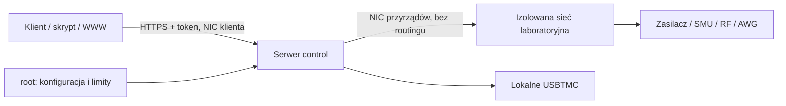

# Architektura i granica zaufania

## Dwa procesy/role, różne uprawnienia

1. `control`: API semantyczne, identyfikacja modelu i serialu, limity root, wyłączanie,
   kontrola odczytu, serializacja, dzierżawa wyjścia, audyt journald. Klient nie podaje
   hosta, portu, modelu ani SCPI w żądaniu. Wybiera tylko nazwę urządzenia z konfiguracji.
2. `usb-gateway`: surowe, jawne transakcje USB. Dla zaufanych skryptów/instrumentów
   pomiarowych, nie jest zabezpieczeniem źródła. Chronione `apply` przez transport
   `gateway` jest celowo zablokowane: otwieranie osobnej transakcji dla każdej komendy
   nie zapewnia atomowego przypięcia tożsamości całego ustawiania. Dla chronionych
   źródeł USB uruchom `control` na samym RPi.

Na jednym RPi mogą działać cztery urządzenia. Gdy którykolwiek ma podlegać limitom,
najprościej użyć wyłącznie trybu `control` dla całej czwórki. Surowa bramka nie może
równolegle udostępniać tego samego źródła niezaufanemu klientowi.

## Root i dwie karty

- NIC klienta ma HTTPS 8840. NIC instrumentów ma statyczny adres, **bez bramy domyślnej**.
- Wyłącz forwarding IPv4/IPv6; nie twórz bridge ani NAT między segmentami.
- Firewall blokuje forward w obie strony, wejście nowych połączeń z sieci przyrządów
  i wyjście procesów innych niż usługa/root na NIC przyrządów.
- W odrębnej sieci nie może być alternatywnego routera, Wi-Fi, hosta klienta ani
  dostępnej klientowi bramki USB/serial. Sam drugi NIC na wspólnym switchu nie izoluje.
- Usługa działa jako `labinst`, bez sudo/capabilities; nie udostępniaj tego konta klientom.
- `/opt/labinst` jest root-owned. `/etc/labinst` i konfiguracja root:labinst bez prawa
  zapisu grupy. Serwer produkcyjny odrzuca ścieżki konfiguracji zapisywalne przez innych
  oraz takie, których dowolny katalog nadrzędny nie należy do roota.
- Wspólny token daje jedną rolę operatora; administracja tylko przez root poza API.
  Token należy przekazywać oddzielnie, rotować w razie ujawnienia, nigdy commitować.
- Root może zawsze zmienić limity albo skomunikować się ze sprzętem — to zamierzona
  granica zaufania. Użytkownik mający fizyczny dostęp do panelu też może ominąć serwer.

## Walidacja i stan źródła

`apply` przyjmuje wyłącznie kompletny, ograniczony zestaw pól. Każda liczba musi być
skończonym JSON number; tekst, bool, NaN, Infinity, dodatkowe pola i zły kanał są odrzucane.
To samo sprawdzamy na odczytanych parametrach. Łączna moc źródła DC jest ograniczona
przez `abs(V) * I_limit`. Dla RF `10^(dBm/10)/1000`. AWG dopuszcza tylko sinusoidę;
konserwatywnie liczymy amplitudę otwartego obwodu jako `2*(abs(offset)+Vpp/2)` i
maksymalny prąd/power-envelope przez 50 ohm. To umyślnie zawyża oszacowanie mocy.

Sekwencja: validate → ID+serial → wszystkie wyjścia OFF i potwierdzenie → ustawienia
→ sprawdzenie trybów i parametrów → ponowna walidacja → opcjonalnie ON i potwierdzenie.
Nie ma oddzielnej komendy ON, która włączyłaby zastane, niezweryfikowane ustawienia.
Awaria po rozpoczęciu konfiguracji powoduje próbę OFF; błąd zatrzaskuje stan i blokuje
kolejne `apply`, aż OFF zostanie potwierdzone. Utrata odpowiedzi nie powoduje ponowienia ON.

Domyślna dzierżawa to 10 s (root może ustawić 1..30 s). Po jej wygaśnięciu watchdog
próbuje wyłączyć wyjście. Start usługi oraz jej normalne zatrzymanie również wykonują OFF
na skonfigurowanych źródłach/obciążeniach, w tym źródle 6487. **Nie uruchamiaj usługi
na aktywnym eksperymencie tylko po to, żeby obejrzeć panel.** Użyj `identify` do inspekcji.

## Rzeczywiste granice zabezpieczeń

To ochrona przed zbyt dużymi żądaniami klienta, nie sprzętowy safety controller.
Nie gwarantuje natychmiastowego odcięcia przy zerwaniu kabla, awarii zasilania RPi,
zablokowaniu firmware'u, błędach samego przyrządu ani przy zewnętrznym wymuszeniu napięcia.
Nie gwarantuje limitu energii, czasu impulsu, overshootu czy zachowania przy zewnętrznym
triggerze. Oczekiwanie na zablokowany transport może opóźnić watchdog o wiele sekund.
Należy ustawić sprzętowe OVP/OCP/OPP/interlock odpowiednie dla DUT.

Ograniczenie mocy obciążenia 8550 zakłada wpisane przez roota `external_voltage_max`;
nie mierzy i nie wyłącza w czasie rzeczywistym przy przekroczeniu napięcia zewnętrznego.
Niezależna ochrona sprzętowa OPP/OVP pozostaje konieczna.

Przed `commissioned=true`: potwierdź prawidłowe tryby DC/CW, brak list/sekwencji,
zewnętrznych triggerów i analogowego sterowania, jednostki, zachowanie po power-on,
wyłącz synchronizację grup i wykonaj testy graniczne z niezależnym miernikiem. Profile
są wąskie; funkcje niezweryfikowane nie powinny być dopisywane jako surowy SCPI z klienta.

SMU to źródło, nie pasywny DMM. Profil v0.1 obsługuje wyłącznie źródło napięciowe DC
z limitem prądu i local sense. Odczyt używa FETCh (ostatni wynik), bez inicjowania pomiaru
mogącego automatycznie włączyć źródło. Nie implementuje jeszcze pomiaru 0 A/remote sense
stosowanego przy wcześniejszym badaniu zasilacza w tym laboratorium.
